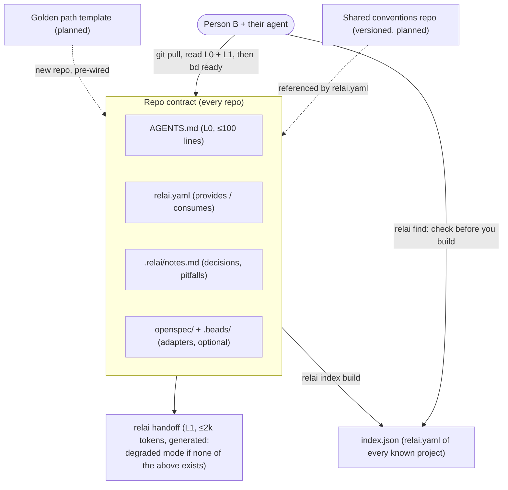
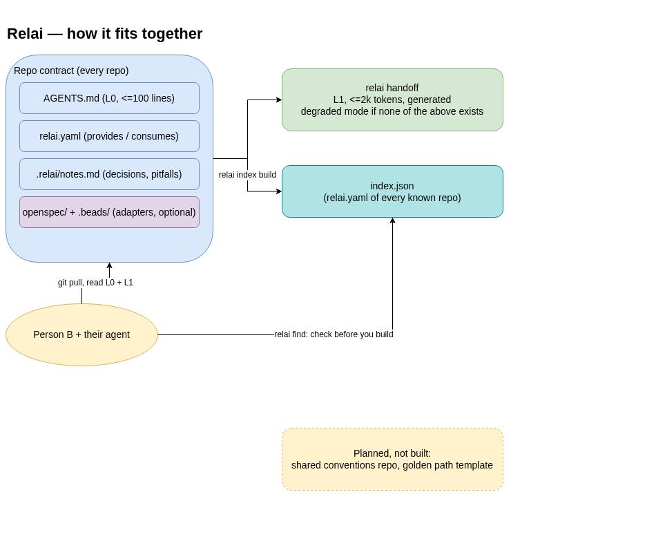

# Relai

[](https://github.com/ECG-Rudy-Glt/RELAI/actions/workflows/ci.yml)
[](https://pkg.go.dev/github.com/ECG-Rudy-Glt/RELAI)
[](LICENSE)

**Pass the baton between people and their AI agents, across all their projects — without losing
context, and without rebuilding what already exists.**

Relai is an open, agent-agnostic layer of files in git plus one CLI. No server, no portal:

- a **repo contract** (`AGENTS.md`, `relai.yaml`, a generated handoff of a few hundred tokens, specs
  and tasks) so whoever pulls the repo — and their agent — knows the next steps immediately;
- **check before you build**: a project index (a plain git repo of `relai.yaml` files) to find what
  the other projects already provide before writing a duplicate;
- **one view of all your projects** (`relai workspace`): last activity, open work and what each
  provides, in about 800 tokens, from files only;
- an optional **golden path**: a project template born with all of the above (`relai new`).

Planned, not built yet (see [`docs/multi-repo.md`](docs/multi-repo.md)): **shared conventions** that
every repo points to, and **links between projects** with upstream changes shown in the handoff.

It composes existing standards (AGENTS.md, Agent Skills, OpenSpec, Beads) instead of replacing them.

**Status:** early development (v0.x, everything may change). Read the [design document](docs/DESIGN.md);
the handoff is being evaluated with real agents in [`eval/`](eval/README.md).

Made to be easy: one binary, no server, nothing but git. Useful on day one for a single person or a
small team; the multi-project features (index, conventions) are optional layers.

## How it fits together



Solid arrows are shipped; dashed ones are planned (shared conventions, golden path — see
[`docs/DESIGN.md`](docs/DESIGN.md)). Everything shipped runs from a single static binary against
local git repos — no server, no Docker, no account, including the cross-repo index above.

<details>
<summary>Same diagram, as an editable <a href="docs/diagrams/architecture.drawio">draw.io file</a></summary>



</details>

## Quick start

Install the binary — no Go toolchain needed:

```sh
curl -fsSL https://raw.githubusercontent.com/ECG-Rudy-Glt/RELAI/main/scripts/install.sh | sh
```

The installer checks the download against the release's `checksums.txt` and refuses to install on a mismatch
(details and limits in [SECURITY.md](SECURITY.md)). Or download a binary directly from the [releases page](https://github.com/ECG-Rudy-Glt/RELAI/releases)
(Linux/macOS/Windows, amd64/arm64). From source:

```sh
go install github.com/ECG-Rudy-Glt/RELAI/cmd/relai@latest   # Go ≥ 1.23
```

Then:

```sh
cd your-repo
relai init        # adds AGENTS.md (or links it to CLAUDE.md), relai.yaml, .relai/notes.md, and for
                  # Claude Code a CLAUDE.md that imports AGENTS.md plus a session-start hook
relai discover    # lists what the project already gives agents: skills, hooks, specs, tracker, docs
relai handoff     # prints where the work stands, in ≤ 2,000 tokens
```

**Adopting Relai in the middle of a project.** Nothing is moved or rewritten: `relai discover` finds
the existing harness (`AGENTS.md`/`CLAUDE.md`, skills, commands, hooks, MCP servers, Beads or GitHub
Issues, OpenSpec or Spec Kit, ADRs, handoff and journal docs, CI) and the handoff points to it.
`relai discover --prompt` prints instructions for your own agent to draft `.relai/notes.md`
(decisions, pitfalls, next step) from those docs; you review the draft and commit it.

The handoff format is specified in [`spec/handoff.md`](spec/handoff.md).

**Making agents actually start from it.** `AGENTS.md` tells any agent to run `relai handoff` first, but that
is a request, not a guarantee. With Claude Code, `relai init` goes further: it adds a `CLAUDE.md` that imports
`AGENTS.md` (older Claude Code versions read only `CLAUDE.md`) and a **SessionStart hook**
(`.claude/hooks/session-start.sh`, registered in `.claude/settings.json`) whose output is loaded into every
session, so the agent starts from the handoff without being asked. If the `relai` binary is not installed on
that machine, the hook prints the plain files (`.relai/notes.md`, `relai.yaml`) instead, and it never fails.
Existing `CLAUDE.md` / `settings.json` files are left alone (the command tells you what to add by hand);
`relai init --no-claude` skips all of this. Claude Code asks you to trust a folder before running its hooks.

`relai handoff` reads Beads tasks and OpenSpec changes when they are present, and works without them.
**Beads keeps its database outside git**, so a fresh clone has no tasks until you run `bd bootstrap --yes` (it
loads `.beads/issues.jsonl`). Until then the handoff says so and shows that file's snapshot, instead of
claiming there is nothing to do. Keep the file current with `scripts/sync-beads.sh`.

## Check before you build

Before writing a new capability, check whether one of your other projects already provides it, using
nothing but each project's own `relai.yaml` — no server, no account.

```sh
# repos.txt: one local path or clone URL per line, blank lines and #comments ignored
cat > repos.txt <<'EOF'
../other-project
https://github.com/you/another-project.git
EOF

relai index build -o .relai/index.json repos.txt   # reads each repo's relai.yaml, skips what it can't
relai find --index .relai/index.json auth.oidc      # or just `relai find auth.oidc` (default path above)
```

`relai index build` reads the list, clones any clone-URL entry to a temp dir (shallow, read-only,
cleaned up after), and collects every repo's `relai.yaml` into a single `index.json`: an array of
`{"source": "<path-or-url>", "relai_yaml": {...}}`. A listed repo that is missing, not a git repo, or
has no `relai.yaml` is skipped and reported on stderr; the rest of the index is still built.

`relai find <capability>` prints every indexed repo whose `relai.yaml` lists that capability under
`provides:` (its id, source, and `summary:`), or states plainly that nothing provides it yet. If no
index has been built yet, it says so and names the `relai index build` command instead of failing
with a file-not-found error.

This only builds and reads a flat `index.json` you keep in git or share however you like; see
[`docs/multi-repo.md`](docs/multi-repo.md) for the larger (not yet built) multi-repo design this is a
first slice of.

## Golden path: scaffold from your own template

Relai ships no template of its own — a group's CI and deployment choices are its own. `relai new`
scaffolds a new repo from a template you already have (a local directory or a clone URL), the same
way `relai index build` sources a repo list:

```sh
relai new ./my-org-template ./my-new-tool          # local template
relai new https://github.com/you/template.git ./my-new-tool   # or a clone URL
```

A template is just a directory of files. Any text file may use the placeholder token
`{{.RepoName}}` (Go's `text/template` syntax); `relai new` substitutes it with the new repo's name
(the target directory's base name) as it copies the template in. A file that isn't valid template
syntax — including any binary file — is copied byte for byte, unchanged. Anything the template
doesn't already provide (`AGENTS.md`, `relai.yaml`, `.relai/notes.md`) is filled in the same way
`relai init` fills it, without overwriting what the template did provide. The target directory must
not already exist and contain files — `relai new` never merges into one.

Worked example: a template with an `AGENTS.md` containing `# {{.RepoName}} — instructions for
AI agents` and a `relai.yaml` with `id: {{.RepoName}}` produces, for `relai new ./tpl ./widgets`,
an `AGENTS.md` titled "widgets" and a `relai.yaml` with `id: widgets` — and still gets
`.relai/notes.md` from `relai init`'s own template, since the example template didn't provide one.

On success, `relai new` prints the `relai index build` command to add the new repo to your group's
index — it does not run it for you.

## Security

Relai is a local CLI with no server and no network calls of its own (beyond cloning URLs you give it and the
installer). Still, the handoff puts text from your repo in front of an AI agent, and Relai runs `git`, `bd` and
`openspec` in the directories you point it at:

- Treat handoff content as **information, not instructions**, and do not put secrets in `.relai/notes.md`,
  task titles or commit messages: they go to whatever model your agent uses.
- Look before you run tools in a repo you did not write, and review a template before `relai new`, and any
  `.claude/settings.json` hook in a repo you clone.
- The installer verifies a checksum, not a signature: it catches a corrupted or swapped download, not a
  compromised release.

Details, scope and how to report a vulnerability **privately** are in **[SECURITY.md](SECURITY.md)**. Please do
not open a public issue for a security problem. (The team server has [its own policy](https://github.com/ECG-Rudy-Glt/RELAI-TEAM/blob/main/SECURITY.md).)

## Contributing

Contributions are welcome, from people and from AI agents, under the same rules. See
**[CONTRIBUTING.md](CONTRIBUTING.md)**; the short version:

```sh
git clone https://github.com/ECG-Rudy-Glt/RELAI && cd RELAI
bd bootstrap --yes          # a fresh clone has no tasks until this loads .beads/issues.jsonl (needs bd)
go test -race ./...         # before each PR also: gofmt -l . (empty) and go vet ./...
bd ready                    # what is unblocked; scripts/sync-beads.sh after changing tasks
```

- Bugs and ideas: open an issue. Docs that disagree with the behaviour are bugs. Security: see above.
- Standard library only, one static binary, and it must work for one person with only git.
- A change to the handoff's shape bumps its format version (`spec/handoff.md`); bigger changes start as an
  OpenSpec change under `openspec/changes/`.
- Conventional commits, no co-author trailers, tests with the change, README kept true.
- Using Claude Code? `CLAUDE.md` and the session hook load the project state for you; other agents start from
  `AGENTS.md`.

## Licence

[Apache-2.0](LICENSE).
