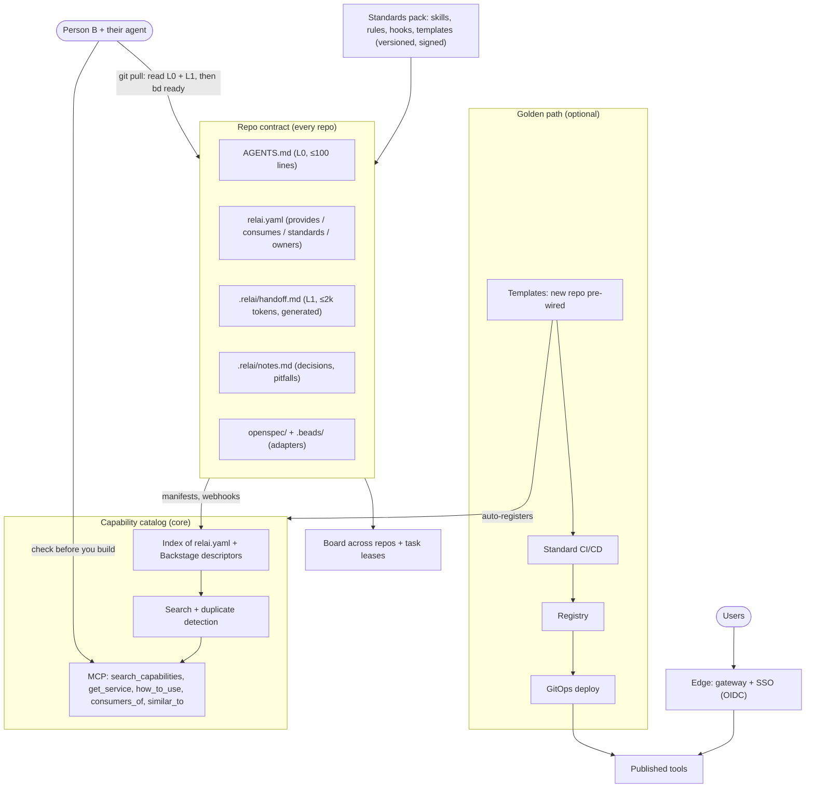

# Relai — design document

> Status: **draft v0.1** (2026-11-02). Design phase, nothing is stable yet.
> Relai (French for *relay*, as in a relay race): pass the baton between people and their AI agents
> without losing context, and without rebuilding what already exists.

## 1. Problem

AI coding agents (Claude Code, Codex, Cursor, Copilot…) made building tools cheap. In a company this
creates three new problems:

1. **Duplication.** Every person or squad builds its own tools with its own agent. Nobody knows what
   already exists, so the same tool gets built several times, each with a different stack and
   different conventions.
2. **Expensive handoffs.** When someone picks up another person's work, their agent has to re-read
   history, issues and docs to figure out where things stand. That is slow, costly in tokens, and
   still misses decisions and pitfalls that were never written down.
3. **Standards that agents cannot see.** Coding, architecture and security norms live in wikis and
   people's heads. Agents do not follow what they cannot read, and nobody checks.

## 2. Goal

An open, tool-agnostic layer that makes **every repository and every organisation agent-native**:

- **Repo contract** — the state of the work (specs, tasks, decisions, next steps) lives in the repo
  in standard formats. Someone pulls, and their agent knows what to do next after reading a few
  thousand tokens, not the whole history.
- **Capability catalog** — every tool or service is registered in an org-wide catalog that agents
  query (over MCP) *before* they build something: reuse or contribute instead of duplicating.
- **Standards pack** — the organisation's norms as machine-readable, versioned rules (skills, hooks,
  linters, CI templates), applied by agents and enforced by CI.
- **Interconnection** — repos declare what they provide and what they consume, so changes propagate
  across projects and teams.
- **Golden path** (optional, reference implementation) — templates → CI/CD → registry → GitOps →
  edge gateway with SSO; new tools are deployed and catalogued automatically.

Non-goals: Relai is not a new agent, not a new task tracker, not a new spec format and not a new
developer portal. It **composes existing standards** and adds the missing glue.

## 3. Building blocks we reuse (do not rebuild)

| Need | Existing standard / tool | Role in Relai |
|---|---|---|
| Instructions for any agent | `AGENTS.md` | Level-0 context, always loaded |
| Tools and data for agents | MCP | Catalog and repo-state access |
| Packaged know-how | Agent Skills (`SKILL.md`) | Standards pack, procedures |
| Distribution to an org | Claude Code plugin marketplaces (and equivalents) | Ships the standards pack |
| Specs and changes | OpenSpec (default), Spec Kit | Spec backend (adapter) |
| Task graph and memory | Beads (default), GitHub Issues, Linear, Jira… | Task backend (adapter) |
| Service catalog | Backstage `catalog-info.yaml` | Catalog format compatibility |
| Shared board humans + agents | Kanzo-like boards | Optional view over tasks |

The market scan (section 11) checks what OpenAI, Anthropic and others already cover.

## 4. Architecture



### 4.1 Token economy: layered context

| Level | Content | Loaded | Budget |
|---|---|---|---|
| L0 | `AGENTS.md` | always | ≤ 100 lines |
| L1 | `.relai/handoff.md` | always (session start hook) | ≤ 2,000 tokens, enforced |
| L2 | specs, task details, catalog, history | on demand, by query (CLI / MCP) | per query |

History is never re-read in full. The handoff is generated deterministically from structured
sources (git, task graph, specs, curated notes): no LLM is needed, so it is cheap, reproducible and
testable. An LLM may optionally rewrite `notes.md`, never the generated parts.

### 4.2 Typical flow

1. A squad needs a tool. Its agent drafts a spec and **queries the catalog first**
   (`similar_to(spec)`). If something close exists, it proposes reuse or contribution and records the
   decision in the spec.
2. Nothing exists: the agent starts from a **golden-path template**. The repo is born with CI/CD, the
   repo contract and the standards pack, and registers itself in the catalog.
3. Work goes on. Before each push, `relai handoff` regenerates the state (done, next, decisions,
   pitfalls). CI runs `relai check` against the standards pack.
4. Someone else takes over: their agent loads L0 + L1 only, and pulls the rest on demand.

## 5. Integration into any project

Relai must fit any repo, language and agent, and be adoptable incrementally:

| Adoption level | What you add | Install needed |
|---|---|---|
| **0 — Contract only** | `AGENTS.md`, `relai.yaml`, `.relai/notes.md` written by hand | none |
| **1 — Local tooling** | `relai init`, `relai handoff`, session-start hook, pre-commit check | CLI |
| **2 — Organisation** | standards pack via marketplace, catalog + MCP server, `relai check` in CI | catalog service |
| **3 — Platform** | golden-path templates, auto-registration, edge + SSO | platform |

Principles:

- **Adapters, not lock-in.** Relai defines the contract and talks to backends through adapters:
  tasks (Beads, GitHub Issues, GitLab, Linear, Jira), specs (OpenSpec, Spec Kit), catalog (built-in,
  Backstage, Port), CI (GitHub Actions, GitLab CI, Forgejo/Gitea Actions).
- **Agent-agnostic.** Everything an agent needs is reachable through `AGENTS.md`, skills, a CLI and
  MCP. Claude-specific wiring (hooks, plugin) is a thin optional layer.
- **Brownfield first.** `relai init` detects what already exists (an `AGENTS.md`, a `CLAUDE.md`, a
  Backstage descriptor, Beads, OpenSpec) and fills the gaps instead of overwriting.
- **No secrets in the contract.** Manifests and handoffs are safe to share; `relai check` includes a
  secret scan.

## 6. Interconnection between projects

Each repo has a `relai.yaml` manifest (draft):

```yaml
apiVersion: relai.dev/v0
id: acme/invoice-pdf            # org/name, unique in the catalog
summary: Generates invoice PDFs from JSON. Used by billing and sales tools.
owners: [team-billing]
standards: acme-standards@2.3   # standards pack version the repo conforms to
provides:
  - capability: pdf.generate.invoice
    interface: { type: http, spec: openapi.yaml, version: 1.4.0 }
    how_to_use: docs/usage.md
consumes:
  - capability: auth.oidc        # resolved by the catalog to a provider repo
    version: ">=2"
  - repo: acme/templates-fonts
links:
  backstage: catalog-info.yaml   # optional, kept in sync
```

What the catalog builds from manifests:

- **Dependency graph** across repos and teams (`consumers_of`, `providers_of`).
- **Impact propagation.** When a provider opens a breaking spec change, the catalog creates
  "impact" tasks in consumer repos (through their task adapter), linked as `acme/invoice-pdf#bd-12`.
  The consumer's next handoff lists *upstream changes affecting you*.
- **Cross-repo task references** with a stable syntax `org/repo#task-id`, resolvable by CLI and MCP.
- **Federation.** Catalogs per team or business unit can federate (pull-based, read-only mirrors)
  into an org catalog, so large companies are not forced into one central instance.
- **Access control.** Catalog reads are scoped by SSO groups; private capabilities stay visible only
  to allowed groups, but duplicate detection can still warn "something similar exists, ask owner X".

## 7. Standards pack

A versioned, signed bundle that encodes an organisation's norms:

- `skills/` (how we design APIs, write ADRs, structure a service, handle secrets…)
- `rules/` machine-checkable rules run by `relai check` (files that must exist, forbidden patterns,
  dependency policies, licence policy, secret scan, AGENTS.md size, handoff budget)
- `templates/` (ADR, spec, CI pipelines per platform, repo scaffolds)
- `hooks/` (optional agent hooks: block destructive commands, inline secrets, unreviewed applies)

Distributed through the agent's plugin marketplace where one exists, and always as plain files plus
CLI so non-Claude agents and CI get the same rules.

## 8. Diagrams and system models

Agents cannot reliably read pictures or ASCII art, and hand-drawn diagrams drift from reality. Relai
treats diagrams as **views generated from models**:

- **Text-first formats only** in repos: Mermaid (renders on GitHub/GitLab/Forgejo), D2, or the C4
  model via Structurizr DSL. `relai check` can flag binary or ASCII-art diagrams in docs.
- **Models as data, diagrams as views.** Network, infrastructure and service topology come from a
  source of truth (IaC state, Kubernetes, NetBox-like inventories, the Relai catalog's dependency
  graph) exported as a typed graph (JSON: nodes, edges, attributes). Diagrams are rendered from that
  graph, so they never drift.
- **Agents query the model, not the picture.** The same graph is exposed over MCP
  (`neighbours_of`, `path_between`, `who_depends_on`, `what_breaks_if`), so an agent can reason about
  a network or a dependency chain and propose a change as a diff to the model.

Scope: inside Relai, only the **conventions** and the catalog's own dependency graph. A generic
"system model" toolkit (importers for Terraform, Kubernetes, firewalls, NetBox; renderers; MCP
queries) is a natural **sibling project**, to start only if phase 4 shows demand.

## 9. Reference implementation and test bed

The author's self-hosted lab already runs every platform piece (Forgejo + Actions, k3s + FluxCD,
Traefik, an OIDC provider, Harbor, Prometheus). It will host the golden-path reference
implementation and end-to-end demos. Lab-specific details stay out of this repo.

## 10. Experiments so far

**E1 — handoff prototype** ([`prototype/handoff.py`](../prototype/handoff.py)), run on a real
infrastructure repo (~420 commits, 51 Beads tasks, 2 OpenSpec changes, very large TODO and journal
files):

| Session start strategy | Approx. tokens |
|---|---|
| Agent reads instructions + TODO + journal + current plan ("naive") | ~96,000 |
| `AGENTS.md` + generated handoff | ~1,700 (handoff alone ~560) |

Estimate based on ~3.6 characters per token. The naive case is a worst case (a careful agent would
read less), but the order of magnitude (~50×) is the point. **Not measured yet:** whether an agent
picks the right next step from the handoff alone — that is experiment E2 (section 12, phase 1).

## 11. Market scan

Web research of 2026-11-02. Items marked *(unverified)* rely on secondary sources only.

**Anthropic.** Org plugin marketplaces are mature: a `marketplace.json` in a git repo bundles skills,
agents, hooks and MCP servers, and managed settings can force-enable or block plugins and
marketplaces fleet-wide ([marketplaces](https://code.claude.com/docs/en/plugin-marketplaces),
[org](https://code.claude.com/docs/en/plugins/org.md)). Agent Skills became an open standard in
December 2025 ([overview](https://inference.sh/blog/skills-agent-skills-overview)); MCP moved to the
Linux Foundation's Agentic AI Foundation (AAIF) the same month
([SD Times](https://sdtimes.com/ai/linux-foundation-forms-agentic-ai-foundation-to-be-new-home-for-mcp-goose-and-agents-md/)).
The public MCP Registry is still in preview and plans private sub-registries
([MCP blog](https://blog.modelcontextprotocol.io/posts/2025-09-08-mcp-registry-preview/)). Team
handoff is limited to the versioned `CLAUDE.md`; sharing a session between teammates is an open
request ([issue](https://github.com/anthropics/claude-code/issues/60082)). No internal tool catalog or
duplicate detection found.

**OpenAI.** `AGENTS.md` came from OpenAI and is now hosted by the AAIF
([InfoQ](https://infoq.com/news/2025/12/agentic-ai-foundation/)). Codex plugins bundle skills, MCP and
hooks, with a workspace directory that admins sync from a GitHub marketplace
([docs](https://learn.chatgpt.com/docs/plugins)). The Agents SDK "handoffs" are runtime transfers
between agents, a different concept. No org capability catalog found.

**GitHub / Microsoft.** Agent HQ orchestrates agents from several vendors
([VSM](https://visualstudiomagazine.com/Articles/2025/10/28/GitHub-Introduces-Agent-HQ-to-Orchestrate-Any-Agent-Any-Way-You-Work.aspx));
custom agents (`.agent.md`) exist at repo and org level
([changelog](https://github.blog/changelog/2025-10-28-custom-agents-for-github-copilot/)); a private MCP
registry policy is in preview
([docs](https://docs.github.com/en/copilot/how-tos/administer-copilot/manage-mcp-usage/restrict-based-on-registry));
Copilot Memory keeps per-repo memories that expire after 28 days
([docs](https://docs.github.com/en/copilot/concepts/agents/copilot-memory)). Spec Kit integrates 30+
agents ([site](https://github.github.com/spec-kit/)).

**Developer portals.** Backstage exposes catalog, templates and search to agents through MCP Actions,
and its catalog now has an `AiResource` kind (types Skill and Rule) and an `mcp-server` API type
([AI docs](https://backstage.io/docs/ai/),
[AI in the catalog](https://backstage.io/docs/next/ai/ai-in-the-catalog)). Port, OpsLevel and
Atlassian (Rovo MCP, GA February 2026) ship official MCP servers
([Port](https://docs.port.io/ai-agents/port-mcp-server), [OpsLevel](https://docs.opslevel.com/do/docs/mcp),
[Atlassian](https://community.atlassian.com/forums/discussion/3186690/announcing-ga-of-the-atlassian-rovo-mcp-server)).
None offers "check before you build" duplicate detection
([Roadie](https://roadie.io/blog/idp-ai-goldmine-context-engineering/)).

**Google.** A2A (agent-to-agent protocol) is at the Linux Foundation and supported by ADK
([Pure AI](https://pureai.com/Articles/2025/06/23/Linux-Foundation-Adopts-Google-Backed-Protocol-for-AI-Agent-Interoperability.aspx)).
It is about agents calling agents at runtime, not about repo continuity.

**Repo-level tools.** Beads ([repo](https://github.com/steveyegge/beads)), OpenSpec
([repo](https://github.com/Fission-AI/OpenSpec)); Trellis is the closest to the repo contract (specs,
tasks and memory in the repo, multi-agent) but has no organisation layer
([docs](https://docs.trytrellis.app/index.md)); Kanzo *(unverified)*. Handoff has **no standard**:
only community skills and CLIs that disagree on name and location
([agent-handoff](https://pypi.org/project/agent-handoff/),
[session-handoff](https://skillselion.com/skills/softaworks/agent-toolkit/session-handoff)).

### Verdict

The idea is **partly covered, and the gap is real**. The pieces exist separately; nobody assembles them
or provides the organisation layer.

- **Commodity — reuse, do not rebuild:** `AGENTS.md`, Agent Skills, plugin marketplaces and managed
  policies (Claude, Codex, Copilot), specs (OpenSpec, Spec Kit), tasks (Beads), the Backstage catalog
  (now with `AiResource` and `mcp-server`), IDP MCP servers, golden-path scaffolding.
- **Missing — Relai's core:**
  1. a **standard, compact, vendor-neutral handoff format**, generated and verifiable against git,
     tasks and specs, with a token budget;
  2. **check before you build**: duplicate detection over the org catalog, exposed over MCP, with a
     reuse-or-contribute decision recorded in the spec;
  3. **`relai check`**: repo conformance to a versioned standards pack, in CI, for any agent;
  4. **cross-repo contracts and tasks** and federated catalogs.
- **Risks:** GitHub or Anthropic shipping team memory/handoff; Backstage or Port adding duplicate
  detection; fast-moving formats (`AiResource`, MCP Registry, diverging marketplaces); ending up as a
  thin wrapper.

**Positioning.** A vendor-neutral *continuity and reuse layer* built on existing standards. Ship three
things nobody has — a verifiable ≤ 2k-token handoff, an anti-duplicate MCP guard on top of the
existing catalog, and a CI-enforceable standards pack — publish the handoff format as an open spec
(with the AAIF as a natural home), and provide adapters for every marketplace rather than competing
with one.

**Consequences for this design:**

- Catalog: **build on Backstage descriptors** (`Component`, `API`, `AiResource`, `mcp-server`) instead
  of a separate catalog format; `relai.yaml` only carries what Backstage lacks (handoff budget,
  standards version, agent-facing capability text), or becomes Backstage annotations.
- Standards pack: distribute through Claude, Codex and Copilot marketplaces; Relai adds the
  conformance check and the version pin, not a new distribution channel.
- Lead with the handoff spec and `relai check` (phases 1–2): smallest surface, clearest gap, useful on
  day one.

## 12. Plan

Each phase ends with acceptance criteria and tests. Phases 1–2 are useful on their own, even if the
catalog never ships.

### Phase 0 — framing (1 week)
- [ ] Market scan and positioning (section 11); confirm the gap is real.
- [ ] Name availability (GitHub org, npm, PyPI, Go module, domain), licence (Apache-2.0 proposed),
  contribution rules (DCO, code of conduct), English-only repo.
- [ ] Decide the implementation language (see open questions).

### Phase 1 — repo contract v0.1 + handoff (2–3 weeks)
- [ ] Spec documents in `spec/`: `relai.yaml` JSON Schema, `.relai/` layout, handoff format and
  budget rules, `notes.md` conventions, `AGENTS.md` ↔ `CLAUDE.md` interplay.
- [ ] CLI: `relai init` (brownfield detection), `relai handoff` (from the prototype, with budget
  enforcement and adapters for Beads/OpenSpec/GitHub Issues), `relai validate`.
- [ ] Session-start integrations: Claude Code hook, generic shell snippet for other agents.
- [ ] **E2 — handoff eval harness**: fixture repos with known "correct next steps"; run several agents
  cold with (a) nothing, (b) naive docs, (c) handoff; measure tokens used and whether the chosen next
  step is right. Target: (c) ≥ (b) on correctness with ≥ 10× fewer tokens.
- Acceptance: E2 target met on at least 3 fixtures and 2 different agents.

### Phase 2 — standards pack + `relai check` (2–3 weeks)
- [ ] Pack format (manifest, versioning, signature), example pack.
- [ ] `relai check` with rule types: required files, forbidden patterns, budgets, secret scan,
  licence and dependency policy; SARIF output for CI annotations.
- [ ] Distribution: Claude Code plugin + plain-files mode; CI actions for GitHub, GitLab, Forgejo.
- Acceptance: the example pack applied to 3 real repos, false positives triaged.

### Phase 3 — capability catalog + MCP (4 weeks)
- [ ] Indexer (git hosts via API/webhooks) for `relai.yaml` and Backstage descriptors.
- [ ] Search: keyword/BM25 baseline first, optional embeddings; duplicate detection on specs.
- [ ] MCP server: `search_capabilities`, `get_service`, `how_to_use`, `consumers_of`,
  `similar_to`; access control through OIDC groups.
- [ ] "Check before you build" skill + hook at spec time.
- [ ] **E3 — duplicate detection eval**: seed a catalog with ~50 tools, ask agents to build tools
  that already exist under other names; measure detection rate and false alarms.
- Acceptance: E3 detection ≥ 80 % with few false alarms; Backstage round-trip works.

### Phase 4 — interconnection (3 weeks)
- [ ] Dependency graph, `org/repo#task` references, impact tasks on breaking changes,
  "upstream changes" section in handoffs, catalog federation.
- Acceptance: a breaking change in a provider creates impact tasks in 2 consumer repos end to end.

### Phase 5 — golden path reference (3 weeks)
- [ ] Templates → CI/CD → registry → GitOps → edge + SSO, auto-registration; demo video.
- Acceptance: "new tool in 15 minutes", visible in the catalog and behind SSO.

## 13. Open questions

1. **Language.** Go (single static binary, like Beads and Kanzo; official MCP Go SDK) vs TypeScript
   (largest MCP ecosystem, npm distribution). Proposal: Go for CLI + MCP server, prototypes in Python.
2. **Handoff in git or generated on the fly?** Committed file (works offline, reviewable, but
   churn and merge conflicts) vs generated at session start (always fresh). Proposal: generated at
   session start, with an optional committed snapshot for releases.
3. **Task leases** across agents and people: lean on the task backend (Beads assignee/status) or a
   catalog-side lock service?
4. **Catalog hosting** for small teams: a git repo of manifests + static index may be enough before a
   server is needed.
5. **`relai.yaml` vs Backstage.** Given Backstage's `AiResource` kind and `mcp-server` API type
   (section 11): a standalone file with a Backstage mapping, or only `relai.dev/*` annotations inside
   `catalog-info.yaml`? Proposal: annotations when Backstage is present, standalone file otherwise,
   same schema.
6. **Where the handoff spec lives long term:** in this repo first; propose it to the AAIF (home of
   `AGENTS.md` and MCP) once two or more agents/tools implement it.
