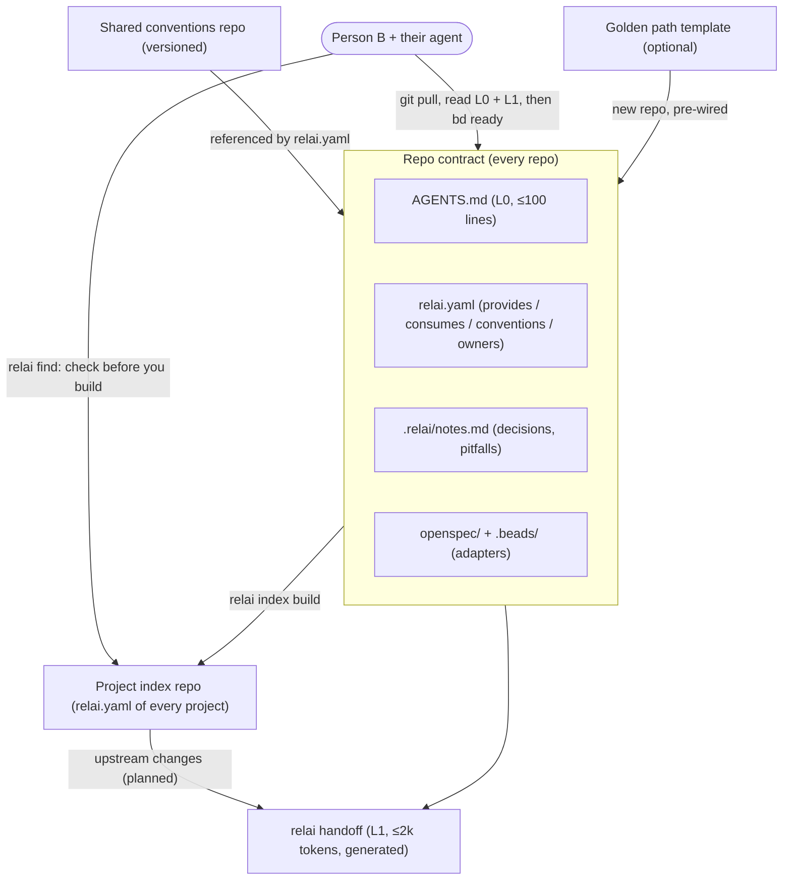

# Relai — design document

> Status: **draft v0.2** (2026-11-03). Design phase, nothing is stable yet.
> Decided: **Go** (single binary, standard library only), **Apache-2.0**, **easy first** — it must be
> useful to one person or a small team with nothing but git; no server, no portal.
> Relai (French for *relay*, as in a relay race): pass the baton between people and their AI agents,
> across all their projects, without losing context and without rebuilding what already exists.

v0.2 refocuses the project on **collaboration between people across projects**. v0.1 drifted
towards an organisation portal (central catalog service, Backstage compatibility, federation, SSO
access control); that is out of scope.

## 1. Problem

AI coding agents (Claude Code, Codex, Cursor, Copilot…) made building tools cheap. When several
people work on several projects, each with their own agent, three problems appear:

1. **Expensive handoffs.** When someone picks up another person's work, their agent has to re-read
   history, issues and docs to figure out where things stand. That is slow, costly in tokens, and
   still misses decisions and pitfalls that were never written down.
2. **Duplication.** Nobody knows what the other projects already provide, so the same tool gets
   built twice, with different stacks and conventions.
3. **Conventions that agents cannot see.** How the group writes code, commits and docs lives in
   people's heads. Agents do not follow what they cannot read.

## 2. Goal

A small, tool-agnostic layer, made of files in git and one CLI, so that **anyone who pulls any of
the group's repos — and their agent — knows where things stand and what exists elsewhere**:

- **Repo contract** — the state of the work (tasks, specs, decisions, next steps) lives in the repo
  in standard formats. Someone pulls, and their agent knows what to do next after reading a few
  thousand tokens, not the whole history.
- **Project index** — every repo describes what it provides in `relai.yaml`; an index of those files
  (a plain git repo) lets people and agents check what exists *before* they build: reuse or
  contribute instead of duplicating.
- **Shared conventions** — one versioned file (or folder) of conventions that repos point to, so every
  agent reads the same rules.
- **Links between projects** — repos declare what they consume; a change upstream shows up in the
  handoff of the projects that depend on it.
- **Golden path** (optional) — a project template born with the repo contract, CI and deployment
  wired, so a new tool starts right and appears in the index.

Non-goals: Relai is not a portal, not a central service, not a new agent, not a new task tracker
and not a new spec format. It **composes existing standards** and adds the missing glue.

## 3. Building blocks we reuse (do not rebuild)

| Need | Existing standard / tool | Role in Relai |
|---|---|---|
| Instructions for any agent | `AGENTS.md` | Level-0 context, always loaded |
| Packaged know-how | Agent Skills (`SKILL.md`) | Shared conventions, procedures |
| Distribution to agents | Claude Code / Codex / Copilot plugin marketplaces | Optional channel for the conventions |
| Specs and changes | OpenSpec (default), Spec Kit | Spec backend (adapter) |
| Task graph and memory | Beads (default), GitHub Issues… | Task backend (adapter) |
| Tools and data for agents | MCP | Optional local access to the index |

The market scan (section 11) checks what OpenAI, Anthropic and others already cover.

## 4. Architecture

Everything is files in git plus one CLI. There is no server.



### 4.1 Token economy: layered context

| Level | Content | Loaded | Budget |
|---|---|---|---|
| L0 | `AGENTS.md` | always | ≤ 100 lines |
| L1 | `relai handoff` | always (session start hook) | ≤ 2,000 tokens, enforced |
| L2 | specs, task details, index, history | on demand (CLI) | per query |

History is never re-read in full. The handoff is generated deterministically from structured
sources (git, task graph, specs, curated notes): no LLM is needed, so it is cheap, reproducible and
testable. An LLM may optionally help curate `notes.md`, never the generated parts.

### 4.2 Typical flow

1. Someone needs a tool. Their agent runs `relai find "<what I need>"` against the project index. If
   something close exists, it proposes reuse or contribution and records the decision.
2. Nothing exists: they start a repo, from the golden-path template if the group has one. The repo
   gets the repo contract and is added to the index.
3. Work goes on. The handoff is regenerated at every session start (done, next, decisions,
   pitfalls, upstream changes).
4. Someone else takes over: their agent loads L0 + L1 only, and pulls the rest on demand.

## 5. Integration into any project

Relai must fit any repo, language and agent, and be adoptable incrementally:

| Adoption level | What you add | Install needed |
|---|---|---|
| **0 — Contract only** | `AGENTS.md`, `relai.yaml`, `.relai/notes.md` written by hand | none |
| **1 — Local tooling** | `relai init`, `relai handoff`, session-start hook | CLI |
| **2 — Several projects** | a project index repo, a shared conventions repo, upstream changes in handoffs | CLI + two git repos |
| **3 — Golden path** | project templates with CI and deployment wired | the group's own CI/hosting |

Level 3's scaffolding mechanism (`relai new <template> <dir>`) shipped in `golden-path-template`
(see `openspec/changes/golden-path-template/`, archived once reviewed). It is bring-your-own
template only — Relai ships none; the "CI and deployment wired" part is whatever template a group
writes for itself.

Principles:

- **Adapters, not lock-in.** Relai defines the contract and talks to backends through adapters:
  tasks (Beads, GitHub Issues…), specs (OpenSpec, Spec Kit), CI (GitHub Actions, GitLab CI,
  Forgejo/Gitea Actions).
- **Agent-agnostic.** Everything an agent needs is reachable through `AGENTS.md`, skills and a CLI.
  Claude-specific wiring (hooks, plugin) is a thin optional layer.
- **Brownfield first.** Most projects adopt Relai half-way through. `relai discover` inventories the
  existing harness (instruction files, skills, commands, hooks, MCP servers, tracker, specs, ADRs,
  handoff and journal docs, CI) and the handoff points to it in a *Harness* section; `relai init`
  fills the gaps without overwriting; `relai discover --prompt` lets the user's own agent draft
  `.relai/notes.md` from the existing docs, for a person to review. E2 on real repos showed the
  handoff saves nothing on repos with no tracker and no notes, so this bootstrap matters.
- **No secrets in the contract.** Manifests and handoffs are safe to share.

## 6. Links between projects

Each repo has a `relai.yaml` manifest (draft):

```yaml
apiVersion: relai.dev/v0
id: team/invoice-pdf            # unique in the index
summary: Generates invoice PDFs from JSON. Used by billing and sales tools.
owners: [alice]
conventions: team/conventions@2.3   # shared conventions version the repo follows
provides:
  - capability: pdf.generate.invoice
    interface: { type: http, spec: openapi.yaml, version: 1.4.0 }
    how_to_use: docs/usage.md
consumes:
  - capability: auth.oidc        # resolved by the index to a provider repo
    version: ">=2"
  - repo: team/templates-fonts
```

The **project index** is a plain git repo holding a copy of (or a pointer to) every `relai.yaml`,
plus a generated static index file. From it the CLI derives:

- **Check before you build** — `relai find` searches capabilities and summaries (keywords first;
  smarter matching only if E3 shows the need).
- **Who depends on what** — `relai consumers <capability>`, `relai providers <capability>`.
- **Upstream changes** — when a provider's breaking change lands, the handoff of each consumer lists
  it under *upstream changes affecting you*.
- **Cross-repo task references** — a stable syntax `team/repo#task-id`, resolvable by the CLI.

An optional local MCP server can expose the same queries to agents; it reads the same index and
needs no hosting.

**Hosted index — deferred, optional, off by default.** For a team that would rather query one
shared endpoint than have each clone build its own `index.json` from `repos.txt`, a small
read-only HTTP service (one Docker image) could serve the same index a `relai index build` already
produces. This stays an *additive* layer: `relai find` keeps working against a local `index.json`
with no server involved, and nothing here reopens the "not a portal" decision (§2) — no auth
beyond what git access already implies, no write path, no central source of truth other than the
`relai.yaml` files committed in each repo. Not built yet; raised while planning
`openspec/changes/adoption-and-cross-repo-index/` (see that change's `design.md`), to be picked up
only once a team actually asks for it rather than speculatively.

## 7. Shared conventions

A versioned git repo (or a folder in the index repo) with the group's conventions:

- `CONVENTIONS.md` — the rules in plain words, short enough for an agent to load;
- `skills/` — optional Agent Skills (how we write ADRs, commits, handle secrets…);
- `templates/` — optional ADR, spec and CI templates.

Repos point to it with `conventions:` in `relai.yaml`; `AGENTS.md` links to it. Distribution through
plugin marketplaces is possible but never required. A light `relai check` (required files present,
`AGENTS.md` size, handoff budget) may come later; heavy policy engines, signing and SARIF are out of
scope.

## 8. Diagrams and system models

Agents cannot reliably read pictures or ASCII art, and hand-drawn diagrams drift from reality:

- **Text-first formats only** in repos: Mermaid (renders on GitHub/GitLab/Forgejo), D2, or the C4
  model via Structurizr DSL.
- **Models as data, diagrams as views.** Where a source of truth exists (IaC state, Kubernetes, the
  project index's dependency graph), diagrams are rendered from it, so they never drift.

A generic "system model" toolkit (importers, renderers, queries) would be a **sibling project**,
only if there is demand.

## 9. Reference implementation and test bed

The author's self-hosted lab already runs every piece of a golden path (Forgejo + Actions, k3s +
FluxCD, Traefik, an OIDC provider, Harbor, Prometheus). It will host the golden-path reference
template and end-to-end demos. Lab-specific details stay out of this repo.

## 10. Experiments so far

**E1 — handoff prototype** ([`prototype/handoff.py`](../prototype/handoff.py)), run on a real
infrastructure repo (~420 commits, 51 Beads tasks, 2 OpenSpec changes, very large TODO and journal
files):

| Session start strategy | Approx. tokens |
|---|---|
| Agent reads instructions + TODO + journal + current plan ("naive") | ~96,000 |
| `AGENTS.md` + generated handoff | ~1,700 (handoff alone ~560) |

Estimate based on ~3.6 characters per token. The naive case is a worst case, but the order of
magnitude (~50×) is the point.

**E2 — handoff eval harness** ([`eval/`](../eval/README.md)): fixture repos with a known next step,
agents run headless and cold in three conditions. Results and protocol in `eval/README.md`.

## 11. Market scan

Web research of 2026-11-02. Items marked *(unverified)* rely on secondary sources only.

**Anthropic.** Org plugin marketplaces are mature: a `marketplace.json` in a git repo bundles skills,
agents, hooks and MCP servers, and managed settings can force-enable or block plugins and
marketplaces fleet-wide ([marketplaces](https://code.claude.com/docs/en/plugin-marketplaces),
[org](https://code.claude.com/docs/en/plugins/org.md)). Agent Skills became an open standard in
December 2025 ([overview](https://inference.sh/blog/skills-agent-skills-overview)); MCP moved to the
Linux Foundation's Agentic AI Foundation (AAIF) the same month
([SD Times](https://sdtimes.com/ai/linux-foundation-forms-agentic-ai-foundation-to-be-new-home-for-mcp-goose-and-agents-md/)).
Team handoff is limited to the versioned `CLAUDE.md`; sharing a session between teammates is an open
request ([issue](https://github.com/anthropics/claude-code/issues/60082)).

**OpenAI.** `AGENTS.md` came from OpenAI and is now hosted by the AAIF
([InfoQ](https://infoq.com/news/2025/12/agentic-ai-foundation/)). Codex plugins bundle skills, MCP and
hooks ([docs](https://learn.chatgpt.com/docs/plugins)). The Agents SDK "handoffs" are runtime
transfers between agents, a different concept.

**GitHub / Microsoft.** Agent HQ orchestrates agents from several vendors
([VSM](https://visualstudiomagazine.com/Articles/2025/10/28/GitHub-Introduces-Agent-HQ-to-Orchestrate-Any-Agent-Any-Way-You-Work.aspx));
custom agents (`.agent.md`) exist at repo and org level
([changelog](https://github.blog/changelog/2025-10-28-custom-agents-for-github-copilot/)); Copilot
Memory keeps per-repo memories that expire after 28 days
([docs](https://docs.github.com/en/copilot/concepts/agents/copilot-memory)). Spec Kit integrates 30+
agents ([site](https://github.github.com/spec-kit/)).

**Developer portals.** Backstage, Port, OpsLevel and Atlassian expose catalogs to agents over MCP
([Backstage AI](https://backstage.io/docs/ai/), [Port](https://docs.port.io/ai-agents/port-mcp-server)).
They are organisation portals that need a server and a platform team: a different audience from
Relai's. None offers "check before you build" duplicate detection
([Roadie](https://roadie.io/blog/idp-ai-goldmine-context-engineering/)).

**Google.** A2A (agent-to-agent protocol) is about agents calling agents at runtime, not about
continuity between people.

**Repo-level tools.** Beads ([repo](https://github.com/steveyegge/beads)), OpenSpec
([repo](https://github.com/Fission-AI/OpenSpec)); Trellis is the closest to the repo contract (specs,
tasks and memory in the repo, multi-agent) but stays inside one repo
([docs](https://docs.trytrellis.app/index.md)); Kanzo *(unverified)*. Handoff has **no standard**:
only community skills and CLIs that disagree on name and location
([agent-handoff](https://pypi.org/project/agent-handoff/),
[session-handoff](https://skillselion.com/skills/softaworks/agent-toolkit/session-handoff)).

### Verdict

The pieces exist separately; nobody assembles them for **people working across several repos with
nothing but git**.

- **Commodity — reuse, do not rebuild:** `AGENTS.md`, Agent Skills, plugin marketplaces, specs
  (OpenSpec, Spec Kit), tasks (Beads), golden-path scaffolding.
- **Missing — Relai's core:**
  1. a **standard, compact, vendor-neutral handoff format**, generated and verifiable against git,
     tasks and specs, with a token budget;
  2. **check before you build** across a group's repos without a portal: a git-based index;
  3. **links between repos** (consumes / provides, upstream changes in the handoff).
- **Risks:** GitHub or Anthropic shipping team memory/handoff; ending up as a thin wrapper; the
  handoff being too easy to copy — the value is in the open format and its adoption.

**Positioning.** A vendor-neutral *continuity layer* between people and their agents, made of files
and one CLI. Publish the handoff format as an open spec (with the AAIF as a natural home) once two or
more tools implement it.

**Team coordination is a separate project.** Relai stays git-only: no server, no running process.
Some teams will want more: a *live* view across repos and claim/release so two agents do not start
the same task. That is built as an optional, separate project,
[RELAI-TEAM](https://github.com/ECG-Rudy-Glt/RELAI-TEAM), which reads Relai's repo contract
(`relai.yaml`, Beads, OpenSpec) through their own CLIs and files; Relai never depends on it. Two
reasons for a separate repository rather than a mode or a second binary here: the claim "git only,
no server" then stays literally true instead of "git only, except…", and the two projects can ship,
version and fail independently, so a rough edge there never reflects on this one. `relai handoff`
mentions it, in one line, only when the repo shows signs of parallel work.

## 12. Plan

Each phase ends with acceptance criteria and tests. Phase 1 is useful on its own.

### Phase 0 — framing
- [x] Market scan and positioning (section 11).
- [x] Language (Go), licence (Apache-2.0), English-only repo.
- [ ] Name availability, `CONTRIBUTING.md`, code of conduct.

### Phase 1 — repo contract v0.1 + handoff
- [ ] **E2 — handoff eval harness** first: fixture repos with known next steps; agents cold with
  (a) nothing, (b) "read the docs", (c) handoff; measure tokens and correctness. Target: (c) as
  correct as (b) with ≥ 10× fewer tokens net of the agent's fixed per-turn overhead (system prompt
  and tool definitions, ~27k tokens for Claude Code). Results drive the format.
- [ ] Spec documents in `spec/`: handoff format and budget rules, `relai.yaml` JSON Schema,
  `.relai/` layout, `notes.md` conventions, `AGENTS.md` ↔ `CLAUDE.md` interplay.
- [ ] CLI: `relai init`, `relai handoff` (adapters for Beads/OpenSpec/GitHub Issues),
  `relai validate`.
- [ ] Session-start integrations: Claude Code hook, generic shell snippet for other agents.
- [ ] Release binaries.
- Acceptance: E2 target met on at least 3 fixtures and 2 different agents.

### Phase 2 — project index and shared conventions
- [ ] Index repo layout, `relai index add`, `relai find`, `relai consumers` / `providers`.
- [ ] Shared conventions repo layout, `conventions:` in `relai.yaml`, link from `AGENTS.md`.
- [ ] Optional local MCP server over the index.
- [ ] **E3 — duplicate detection eval**: an index of ~50 tools, agents asked to build tools that
  already exist under other names; measure detection rate and false alarms.
- Acceptance: E3 detection ≥ 80 % with few false alarms, keyword search first.

### Phase 3 — links between projects
- [ ] `team/repo#task` references, "upstream changes" section in handoffs, impact tasks on
  breaking changes.
- Acceptance: a breaking change in a provider shows up in 2 consumer handoffs end to end.

> Team coordination (live board, claim/release, MCP tools) is tracked in
> [RELAI-TEAM](https://github.com/ECG-Rudy-Glt/RELAI-TEAM)'s own plan, not as a phase here.

### Phase 4 — golden path reference (optional)
- [x] Scaffolding mechanism: `relai new <template> <dir>` (`golden-path-template` change) — the
  mechanism only, no shipped template.
- [ ] A real project template (repo contract, CI, deployment) that proves it, added to the index
  on creation. Deliberately out of scope of `golden-path-template`'s own change — see its
  design.md Non-Goals.
- Acceptance: "new tool in 15 minutes", in the index, deployed. Not yet met — needs a real
  template and real CI/hosting (owner's validation exercise, not shipped code).

## 13. Open questions

1. ~~**Language.**~~ Decided 2026-11-02: Go.
2. **Handoff in git or generated on the fly?** Proposal: generated at session start, with an
   optional committed snapshot for releases.
3. **Task leases** across agents and people: lean on the task backend (Beads assignee/status).
4. **Index contents:** copies of each `relai.yaml` pushed by `relai index add`, or pointers fetched
   at build time?
5. **Where the handoff spec lives long term:** in this repo first; propose it to the AAIF once two or
   more agents/tools implement it.
