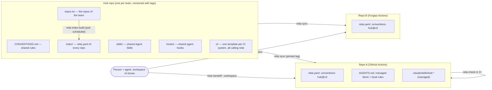

# Relai across many repos and CI systems

> Status: proposal (2026-11-03), to be reviewed before implementation. Phase 2 of
> [`DESIGN.md`](DESIGN.md). Same constraints as the rest of Relai: git only, one binary, no server,
> no portal.

## 1. The problem

A person or a small team works on many repos: some on GitHub with GitHub Actions, some on a
self-hosted Forgejo, some on GitLab. Each repo has grown its own `AGENTS.md`/`CLAUDE.md`, skills,
hooks and CI. The result:

- the same rule (commit style, secrets handling, "never push --force") is copied in ten places and
  drifts;
- a new rule takes ten manual edits, some forgotten;
- every CI system needs its own YAML to run the same checks;
- nobody, human or agent, sees where all the projects stand without opening each one.

## 2. Strategy in one picture



Five rules:

1. **One hub repo holds what is shared**, versioned with git tags. Repos pin a version.
2. **Shared content is vendored into each repo, inside managed blocks**, never referenced from a
   URL at run time: every agent, offline or not, reads plain files in the repo it works on.
3. **The logic lives in the `relai` binary, not in CI YAML**: each CI system only gets a few lines
   that call `relai check`, so GitHub, Forgejo and GitLab behave the same.
4. **The index is pulled, not pushed**: the hub builds it from `repos.txt` on a schedule, so no repo
   needs write access to the hub.
5. **A workspace view** gives one compact handoff for all the repos a person has cloned.

## 3. The hub repo

```
team-hub/
├── CONVENTIONS.md        # shared rules, ≤ 100 lines, plain words — what agents must follow
├── skills/<name>/SKILL.md
├── hooks/                # agent hooks (e.g. block force-push, block inline secrets), + settings snippets
├── ci/
│   ├── github.yml        # GitHub Actions job calling relai
│   ├── forgejo.yml       # Forgejo / Gitea Actions (same syntax, different path)
│   └── gitlab.yml        # GitLab CI include
├── repos.txt             # one clone URL per line
└── index/                # generated: one relai.yaml per repo + index.json
```

Optionally the hub is also published as a Claude Code / Codex plugin marketplace, so those agents
can install the skills and hooks natively. That channel is a convenience; `relai sync` is the path
that works for every agent.

## 4. In each repo

`relai.yaml` pins the hub:

```yaml
conventions:
  hub: https://forge.example/team/team-hub.git
  version: v3          # a git tag of the hub
  skills: [secrets-handling, commit-style]   # which shared skills to install; default: all
```

`relai sync` (run by a person, or by a scheduled job that opens a pull request):

- fetches the hub at the pinned tag into a local cache;
- rewrites only the **managed blocks**, delimited by markers, and never touches anything else:

  ```markdown
  <!-- relai:conventions hub@v3 — managed by `relai sync`, edit the hub instead -->
  …content of CONVENTIONS.md…
  <!-- /relai:conventions -->

  ## This repo
  …local rules, written by hand…
  ```

- installs the selected shared skills under a prefix (`.claude/skills/hub-<name>/`, and
  `.agents/skills/` for other agents), so local skills keep their names;
- adds the CI template for the repo's CI system **once**, if the repo has none (it detects
  `.github/`, `.forgejo/`, `.gitea/`, `.gitlab-ci.yml` with `relai discover`);
- prints a diff; a person reviews and commits.

**Precedence**, from weakest to strongest: hub conventions → the repo's local rules → a
subdirectory `AGENTS.md`. A repo that departs from a hub rule says so in its local rules, with the
reason; `relai check` lists those overrides so they stay visible.

## 5. CI, whatever the system

Every template runs the same commands:

```sh
relai check             # repo contract valid, AGENTS.md ≤ 100 lines, handoff within budget,
                        # managed blocks identical to hub@<pinned version> (no hand edits, no drift)
relai check --outdated  # warning only: a newer hub tag exists
```

GitHub Actions and Forgejo/Gitea Actions share the same YAML (only the folder differs); GitLab gets
an `include`. Because the logic is in the binary, adding a rule never means editing three CI
dialects.

## 6. The project index

- `repos.txt` lists the team's repos. A scheduled job in the hub (`relai index build`) clones or
  fetches each one read-only, copies its `relai.yaml` into `index/`, and writes `index/index.json`.
- `relai find "<need>"` searches it before building something new; `relai consumers <capability>`
  shows who depends on what.
- Pull-based: one read token in the hub instead of a write token in every repo, and repos on
  different forges are indexed the same way.

## 7. The workspace view

A person usually has several of the team's repos cloned side by side. `relai handoff --workspace
<dir>` (or a `relai-workspace.yaml` listing paths) prints one block per repo, a few lines each:
branch and state, the *Check first* lines, the top in-progress and ready tasks, the `next:` of
active changes, the `### Next` of the notes — plus *upstream changes* when a repo it consumes
changed. Same rules as the single-repo handoff (deterministic, budgeted, pointers to
`relai handoff <repo>` for detail).

## 8. Adopting it on existing repos

1. Create the hub from the rules the repos already share: `relai discover` on each repo lists their
   instruction files, skills and hooks; the common parts move to the hub, the specific parts stay
   local. An agent can draft the split; a person decides.
2. In each repo: `relai init` (if not done), add `conventions:` to `relai.yaml`, `relai sync`,
   review the diff, commit. Duplicated rules in the local part are deleted in the same commit.
3. Add the repo to `repos.txt`.

## 9. What this is not

- Not a service: the hub is a git repo, the index is a JSON file in it.
- Not a policy engine: `relai check` verifies the contract and drift, not code quality; existing
  linters stay where they are.
- Not a replacement for plugin marketplaces: the hub can feed one.

## 10. Open questions

1. Managed blocks in `AGENTS.md` only, or also in `CLAUDE.md` when it is not a link to
   `AGENTS.md`?
2. Shared hooks: vendored scripts plus a settings snippet merged into `.claude/settings.json`, or
   only documented, since merging JSON settings is more invasive?
3. Should `relai sync` open the pull request itself (needs a forge token) or leave it to the
   existing bots (Renovate can bump a version in `relai.yaml`)?
4. Test bed: the author's repos span GitHub (Actions) and a self-hosted Forgejo (Actions), which
   covers two CI systems; GitLab needs a test repo.
