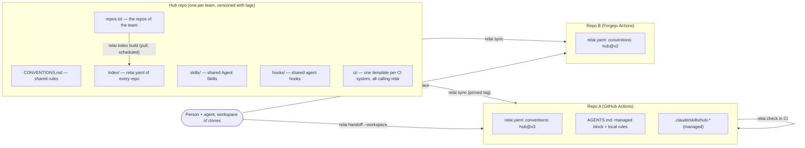

# Relai across many repos and CI systems

> Status: **built** (2026-11-16): `relai hub init`, `relai sync` and `relai check` exist; the
> decisions are in `openspec/changes/shared-conventions-hub/design.md`. Where this document says
> otherwise, the sections below have been brought in line (§4, §10); `consumers`, shared hooks, pull
> request automation and per-repo skill selection are **not** built. Phase 2 of
> [`DESIGN.md`](DESIGN.md). Same constraints as the rest of Relai: git only, one binary, no server,
> no portal.

## 1. The problem

A person or a small team works on many repos: some on GitHub with GitHub Actions, some on a
self-hosted Forgejo, some on GitLab. Each repo has grown its own `AGENTS.md`/`CLAUDE.md`, skills,
hooks and CI. The result:

- the same rule (commit style, secrets handling, "never push --force") is copied in ten places and
  drifts;
- a new rule takes ten manual edits, some forgotten;
- every CI system needs its own YAML to run the same checks;
- nobody, human or agent, sees where all the projects stand without opening each one.

## 2. Strategy in one picture



Five rules:

1. **One hub repo holds what is shared**, versioned with git tags. Repos pin a version.
2. **Shared content is vendored into each repo, inside managed blocks**, never referenced from a
   URL at run time: every agent, offline or not, reads plain files in the repo it works on.
3. **The logic lives in the `relai` binary, not in CI YAML**: each CI system only gets a few lines
   that call `relai check`, so GitHub, Forgejo and GitLab behave the same.
4. **The index is pulled, not pushed**: the hub builds it from `repos.txt` on a schedule, so no repo
   needs write access to the hub.
5. **A workspace view** gives one compact handoff for all the repos a person has cloned.

## 3. The hub repo

```
team-hub/
├── CONVENTIONS.md        # shared rules, ≤ 100 lines, plain words — what agents must follow
├── skills/<name>/SKILL.md
├── hooks/                # agent hooks (e.g. block force-push, block inline secrets), + settings snippets
├── ci/
│   ├── github.yml        # GitHub Actions job calling relai
│   ├── forgejo.yml       # Forgejo / Gitea Actions (same syntax, different path)
│   └── gitlab.yml        # GitLab CI include
├── repos.txt             # one clone URL per line
└── index/                # generated: one relai.yaml per repo + index.json
```

Optionally the hub is also published as a Claude Code / Codex plugin marketplace, so those agents
can install the skills and hooks natively. That channel is a convenience; `relai sync` is the path
that works for every agent.

## 4. In each repo

`relai.yaml` pins the hub on **one line** (the file format has no nested mappings):

```yaml
conventions: https://forge.example/team/team-hub.git@v3   # <hub>@<tag>, split on the last @
```

`relai sync` is a **dry run**: it prints what it would change. `relai sync --apply` does it, and
never commits; a person reviews the diff and commits. `--refresh` fetches the hub again instead of
using the cached copy. It:

- fetches the hub at the pinned tag (`git clone --depth 1 --branch <tag>`) into the user cache
  directory, never into the repository;
- writes the hub's `CONVENTIONS.md` as a whole file, `.relai/conventions.md`, which starts with one
  generated-marker line. It is not pasted into `AGENTS.md`, whose 100-line budget it would eat;
- keeps a **three-line managed block** in `AGENTS.md` that points to that file, and touches nothing
  else in `AGENTS.md` (the block goes before the first `## ` heading, or at the end; `AGENTS.md` is
  never created; it is written through a symbolic link that stays inside the repository):

  ```markdown
  <!-- relai:conventions <hub>@v3 — managed by `relai sync`, edit the hub instead -->
  Shared conventions of the hub: [.relai/conventions.md](.relai/conventions.md). The local rules of this file come after them and win.
  <!-- /relai:conventions -->
  ```

- copies every hub `skills/<name>/` to `.claude/skills/hub-<name>/` and `.agents/skills/hub-<name>/`
  (local skills keep their names), and removes a `hub-*` folder the hub no longer has;
- installs the CI job **once**, when the file is absent, for the CI folder the repository already has:
  `ci/github.yml` to `.github/workflows/relai.yml`, `ci/forgejo.yml` to `.forgejo/workflows/relai.yml`
  or `.gitea/workflows/relai.yml`. For GitLab it prints the lines to add and never edits
  `.gitlab-ci.yml`. A repository with none of these gets no CI file.

Hub content is untrusted. Names containing `..`, symbolic links (skipped and reported, never
followed) and files over 1 MiB are not copied, and `sync` writes only to the paths listed above,
inside the repository.

**Precedence**, from weakest to strongest: hub conventions, the repo's local rules, a
subdirectory `AGENTS.md`. A repo that departs from a hub rule says so in a local line that starts
with `Override:` and gives the reason; `relai check` lists those lines (level "info", never a failure)
so they stay visible.

`relai hub init <dir>` creates a hub in an empty directory (a conventions file, one sample skill,
the three CI templates, `repos.txt`); commit it and tag a version.

## 5. CI, whatever the system

Every template runs the same commands:

```sh
relai check             # repo contract valid, AGENTS.md ≤ 100 lines, handoff within budget,
                        # managed blocks identical to hub@<pinned version> (no hand edits, no drift)
relai check --outdated  # warning only: a newer hub tag exists
```

GitHub Actions and Forgejo/Gitea Actions share the same YAML (only the folder differs); GitLab gets
an `include`. Because the logic is in the binary, adding a rule never means editing three CI
dialects.

## 6. The project index

- `repos.txt` lists the team's repos. A scheduled job in the hub (`relai index build`) clones or
  fetches each one read-only, copies its `relai.yaml` into `index/`, and writes `index/index.json`.
- `relai find "<need>"` searches it before building something new; `relai find --consumers <capability>`
  shows who depends on what.
- Pull-based: one read token in the hub instead of a write token in every repo, and repos on
  different forges are indexed the same way.

## 7. The workspace view

A person usually has several of the team's repos cloned side by side. `relai handoff --workspace
<dir>` (or a `relai-workspace.yaml` listing paths) prints one block per repo, a few lines each:
branch and state, the *Check first* lines, the top in-progress and ready tasks, the `next:` of
active changes, the `### Next` of the notes — plus *upstream changes* when a repo it consumes
changed. Same rules as the single-repo handoff (deterministic, budgeted, pointers to
`relai handoff <repo>` for detail).

**What exists today.** `relai handoff --workspace <folder> [--depth N]` (2026-11-17) prints one block per git
repository found in the folder (symbolic links followed, a repository found twice is shown once): branch and
uncommitted files, last commit, open and in-progress task counts with the top tasks, the `next:` of each
active change, the `### Next session` lines of the notes, and *upstream changes*: for each repository the
`links:` of its `relai.yaml` name and that sits in the same folder, the number of commits made there after
the last commit here. Everything is read from files and git, never `bd` or `openspec`, so the task counts
come from the committed `.beads/issues.jsonl`: each block says the date of that copy, flags it when it is
older than the repository's last commit, and says how many unfinished epics are not counted (`bd list`
counts them). The single-repository handoff gets the same *Upstream changes* section (format v0.10) when a
linked repository next to it moved. `relai workspace` is the older, index-based view (`relai index build`).
`relai index build --scan` and `relai discover --links` find the repositories of a folder and the mentions
between them (evidence for a person or agent to confirm; `relai.yaml` gets an optional `links:`).
Not built: a `relai-workspace.yaml` listing paths, *Check first* lines in the workspace blocks.

## 8. Adopting it on existing repos

1. Create the hub from the rules the repos already share: `relai discover` on each repo lists their
   instruction files, skills and hooks; the common parts move to the hub, the specific parts stay
   local. An agent can draft the split; a person decides.
2. In each repo: `relai init` (if not done), add `conventions:` to `relai.yaml`, `relai sync`,
   review the diff, commit. Duplicated rules in the local part are deleted in the same commit.
3. Add the repo to `repos.txt`.

## 9. What this is not

- Not a service: the hub is a git repo, the index is a JSON file in it. This holds for Relai
  itself. A team that also wants a live board and claim/release across repos can run the separate,
  optional [RELAI-TEAM](https://github.com/ECG-Rudy-Glt/RELAI-TEAM) server, which reads the same
  repo contract; Relai does not depend on it.
- Not a policy engine: `relai check` verifies the contract and drift, not code quality; existing
  linters stay where they are.
- Not a replacement for plugin marketplaces: the hub can feed one.

## 10. Open questions

Decided on 2026-11-16 (see the design of the change `shared-conventions-hub`):

1. `AGENTS.md` only for the managed block; `CLAUDE.md` is left alone (it is usually a link to it).
2. Shared hooks are **not** synced in this version: merging JSON settings is invasive.
3. `relai sync` does not open the pull request; a bot (Renovate can bump the tag in `relai.yaml`)
   or a person does.
4. The CI templates for GitHub and Forgejo/Gitea are the same job; the GitLab one is untested, and a
   GitLab test repository is still needed.

Still open: per-repo skill selection (all hub skills are installed), the `consumers` command, and
and a `relai-workspace.yaml` listing paths.
