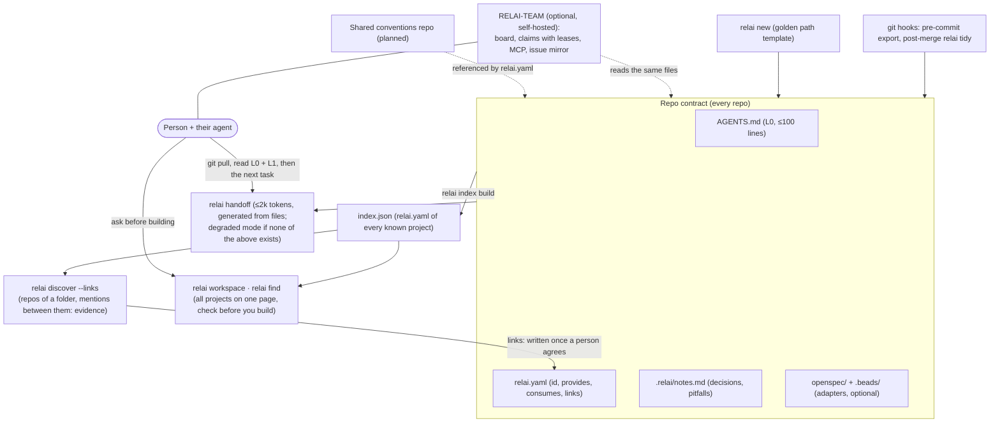
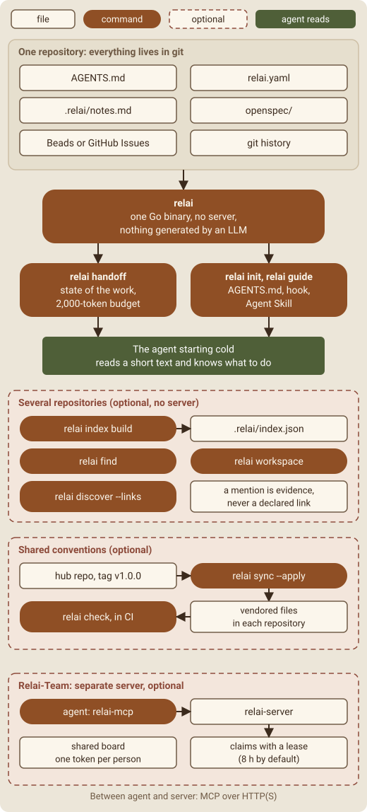
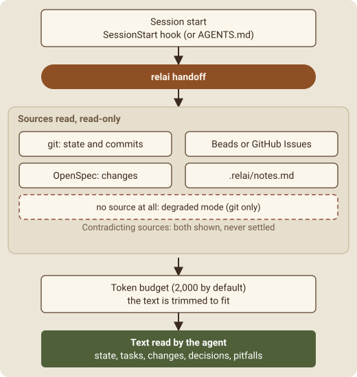
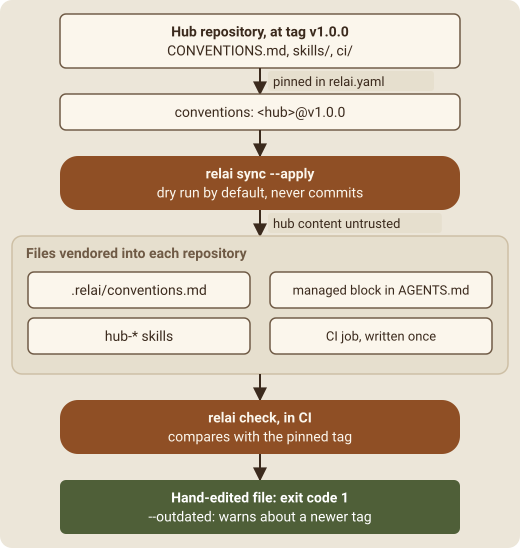

# Using relai in depth

The full usage guide that used to live in the README. The README has the short version; the command list is in `relai help`.

### Shared conventions from a hub

A hub is a git repository with a `CONVENTIONS.md`, optional `skills/<name>/` and `ci/` templates.
`relai hub init <dir>` makes one; tag a version (`v1.0.0`). A repository pins it with one line in
`relai.yaml`, `conventions: <hub>@<tag>`, then:

```sh
relai sync            # dry run: what would change
relai sync --apply    # vendors .relai/conventions.md, a 3-line block in AGENTS.md, hub-* skills, a CI job once
relai check           # relai validate + handoff budget + no drift from the hub at the pinned tag; exit 1 on a problem
relai check --outdated   # warns when the hub has a higher version tag
```

`sync` never commits and never writes outside the repository; hub content is treated as untrusted.
A local line starting with `Override:` in `AGENTS.md` records a departure from a hub rule; `check`
lists it and still passes. Shared hooks, pull-request automation and per-repo skill selection are not built.

It composes existing standards (AGENTS.md, Agent Skills, OpenSpec, Beads) instead of replacing them.

**Status:** early development (v0.x, everything may change). Read the [design document](DESIGN.md);
the handoff is being evaluated with real agents in [`eval/`](../eval/README.md).

Made to be easy: one binary, no server, nothing but git. Useful on day one for a single person or a
small team; the multi-project features (index, conventions) are optional layers.

**Who gets what.** Measured on a real set of 16 repositories of one developer working alone with agents:
`relai workspace` (the overview of every project, about 400 tokens) and the handoff are what pay off today.
The team board ([RELAI-TEAM](https://github.com/ECG-Rudy-Glt/RELAI-TEAM)) answers a problem that starts when
several people or agents work in parallel on the same projects; with a single human it adds little. Savings
were measured once per case: treat them as indications, not as a guarantee.

## How it fits together



Solid arrows are shipped. Dashed ones are planned (shared conventions, see [`docs/DESIGN.md`](DESIGN.md)) or
belong to the separate optional board. Everything in Relai itself runs from a single static binary against
local git repos — no server, no Docker, no account, including the cross-repo index above.



At session start:



Shared conventions:


## Quick start

Install the binary — no Go toolchain needed:

```sh
curl -fsSL https://raw.githubusercontent.com/ECG-Rudy-Glt/RELAI/main/scripts/install.sh | sh
```

The installer checks the download against the release's `checksums.txt` and refuses to install on a mismatch
(details and limits in [SECURITY.md](../SECURITY.md)). Or download a binary directly from the [releases page](https://github.com/ECG-Rudy-Glt/RELAI/releases)
(Linux/macOS/Windows, amd64/arm64). From source:

```sh
go install github.com/ECG-Rudy-Glt/RELAI/cmd/relai@latest   # Go ≥ 1.21 fetches the pinned toolchain (1.26.10) by itself
```

Then:

```sh
cd your-repo
relai init        # adds AGENTS.md (or links it to CLAUDE.md), relai.yaml, .relai/notes.md, and for
                  # Claude Code a CLAUDE.md that imports AGENTS.md plus a session-start hook
relai discover    # lists what the project already gives agents: skills, hooks, specs, tracker, docs
relai handoff     # prints where the work stands, in ≤ 2,000 tokens
relai guide       # prints a short how-to for any AI agent; `relai guide --install` writes it as a user-level
                  # Agent Skill (~/.claude/skills/relai, ~/.agents/skills/relai); `--force` overwrites a differing file
```

Flags can go before or after the arguments (`relai init --no-claude dir` and `relai init dir --no-claude` are the same).
`relai init --hooks` also installs a git **pre-commit hook** that keeps `.beads/issues.jsonl` (the copy of the task list
that lives in git) current, in the very commit that changes the tasks. It asks `bd` only when `bd` wrote since the
last export, never blocks a commit, and never overwrites a hook you already have.

**Adopting Relai in the middle of a project.** Nothing is moved or rewritten: `relai discover` finds
the existing harness (`AGENTS.md`/`CLAUDE.md`, skills, commands, hooks, MCP servers, Beads or GitHub
Issues, OpenSpec or Spec Kit, ADRs, handoff and journal docs, CI) and the handoff points to it.
`relai discover --prompt` prints instructions for your own agent to draft `.relai/notes.md`
(decisions, pitfalls, next step) from those docs; you review the draft and commit it.

The handoff format is specified in [`spec/handoff.md`](../spec/handoff.md).

**Making agents actually start from it.** `AGENTS.md` tells any agent to run `relai handoff` first, but that
is a request, not a guarantee. With Claude Code, `relai init` goes further: it adds a `CLAUDE.md` that imports
`AGENTS.md` (older Claude Code versions read only `CLAUDE.md`) and a **SessionStart hook**
(`.claude/hooks/session-start.sh`, registered in `.claude/settings.json`) whose output is loaded into every
session, so the agent starts from the handoff without being asked. If the `relai` binary is not installed on
that machine, the hook prints the plain files (`.relai/notes.md`, `relai.yaml`) instead, and it never fails.
Existing `CLAUDE.md` / `settings.json` files are left alone (the command tells you what to add by hand);
`relai init --no-claude` skips all of this. Claude Code asks you to trust a folder before running its hooks.

**Other agents.** The hook is plain POSIX shell with nothing specific to Claude Code in it. Any agent that can
run a command when a session starts and read what it prints can use the same three lines:

```sh
#!/bin/sh
# session start: print the project's state; never fail
relai handoff 2>/dev/null || cat .relai/notes.md relai.yaml 2>/dev/null
exit 0
```

Register it wherever your agent takes a session-start command. An agent with no such hook still gets there
through `AGENTS.md`, whose first instruction is to run `relai handoff`.

### Check the contract: `relai validate`

```sh
relai validate            # exit 1 on an error
relai validate --strict   # exit 1 on a warning too: use this one in CI
relai validate --json     # the findings as JSON
```

It checks `relai.yaml` against its one-page specification, [`spec/relai-yaml.md`](../spec/relai-yaml.md)
(required `id` and `summary`, names, values that were not understood, unknown keys such as a mistyped
`provide:`), that `AGENTS.md` stays within 100 lines, and that `.relai/notes.md` exists. In a CI job:
`relai validate --strict`.

`relai.yaml` is meant to be read by other tools too. The specification fits on one page, has a version field
and a compatibility rule, a JSON Schema ([`spec/relai.schema.json`](../spec/relai.schema.json)), conformance
cases ([`spec/conformance/`](../spec/conformance/)) and a second reader in Python
([`spec/readers/relai_yaml.py`](../spec/readers/relai_yaml.py)) written from the page alone.

`relai handoff` reads Beads tasks and OpenSpec changes when they are present, and works without them.

**Tasks in GitHub Issues instead of Beads?** Add one line to `relai.yaml`:

```yaml
tasks: github
```

The handoff then lists the open issues with the `gh` command (assigned ones first). It is the only network
call a handoff can make, it is never made without that line, and `RELAI_NO_GH=1` turns it off on a machine.

**On GitLab?** Write `tasks: gitlab` instead. The handoff then lists the open issues with the official
[`glab`](https://gitlab.com/gitlab-org/cli) command (`glab issue list`), whether the project is on gitlab.com
or on your own server: relai handles no token and no URL, `glab` takes both from the repository's remote and
from its own sign-in (`glab auth login`). Same rules: opt-in, one call, 8 seconds at most, switched off by
`RELAI_NO_GH=1`, and when `glab` is missing or fails the handoff says so.

**For other tools.** `relai handoff --json` and `relai workspace --json` print the same facts as data, so an
MCP server, a memory tool or a service catalog can read them without parsing Markdown. Relai depends on none
of them.

### Keep the notes in shape: `relai note`

`.relai/notes.md` is the project's memory: what was decided, what cost time once. It only helps while it stays
short and true.

```sh
relai note add "Use JSON output for integrations — no parsing of Markdown"   # under Decisions, dated today
relai note add --pitfall "bd export writes the owner's e-mail → use scripts/sync-beads.sh"
relai note add --next "Merge PR 12, then tag"
relai note check                    # size against the handoff budget, entries older than 90 days
relai note archive --days 180       # what would move to .relai/notes-archive.md; --apply does it
```

Nothing is rewritten or summarised: whole lines are added or moved, and you commit the result.
**Beads keeps its database outside git**, so a fresh clone has no tasks until you run `bd bootstrap --yes` (it
loads `.beads/issues.jsonl`). Until then the handoff says so and shows that file's snapshot, instead of
claiming there is nothing to do. Keep the file current with `scripts/sync-beads.sh`.

## One view of all your projects

```sh
relai index build repos.txt      # once: collect each project's relai.yaml (paths or clone URLs)
relai workspace                  # ≈ 400 tokens for 16 repos: every project, most recently active first
```

For each indexed project `relai workspace` shows the date of its last commit, how many tasks are open and in progress,
the most urgent ones, and what it provides. It reads files only (the index, each project's `.beads/issues.jsonl`, the
last commit date) and never runs `bd`, so asking about twenty projects does not rewrite twenty databases. The task
counts come from the committed copy of the task list and can lag the live one; the output says so. Projects given as
clone URLs are listed but not read. Use `--max-tokens` to change the budget: detail is dropped first, then the least
active projects are named without detail, then only counted.

To see where the work stands in the repositories you have cloned side by side, without an index:

```sh
relai handoff --workspace ~/projets --depth 2     # one block per repository, ≤ 1,500 tokens by default
```

Each block has the branch and uncommitted files, the open and in-progress tasks (with the date of the committed list
they come from, a warning when it is older than the last commit, and the number of unfinished epics that are not
counted), the `next:` of each active change and the *Next session* notes. A project's `links:` that point to a
repository in the same folder add an *upstream changes* line: how many commits were made there after the last
commit here. The single-repository `relai handoff` shows the same section when a linked repository next to it moved.

`relai handoff` stays the answer for one project: it is the same idea at the scale of one repository, and it now asks `bd`
only when the project changed since the last time (the answers are cached in your user cache directory, never in the repo).

## Find your projects and how they relate

You do not have to write the list of your projects by hand:

```sh
relai index build --scan ~/projects      # every git repo of the folder (symlinks included); says which need `relai init`
relai index build --scan ~/work --scan ~/oss # --scan is repeatable and adds up (also with a list file and --depth); a repo reached by several --scan folders is indexed once
relai discover --links ~/projects        # the mentions between them: who points at whom, and how strongly
relai discover --links ~/projects --depth 2  # also look one folder deeper (nested repos are named by path)
relai discover --links ~/projects --prompt   # instructions for your agent to check each mention with you
relai discover --links ~/projects --propose  # a `links:` block per relai.yaml to check and paste yourself
```

The result is **evidence, not a verdict**. *Strong*: a repository holds the other's remote URL or a relative path to it (a
deployment manifest pointing at an application). *Weak*: its name appears as a word (it can be an ordinary word, and names
under four letters are not searched this way). Each line shows counts and up to three file paths, never content, and
generated files (`node_modules`, `vendor`, lock files, `graphify-out`) are ignored. A name found in two or more CI, deployment or
configuration files (workflows, k8s, compose, yaml) is proposed by `--propose` even without strong evidence, because that is far
more often a real dependency than a name in a document; documents alone need `--min-weak` files (default 2). Weak mentions skip a repository's own task, notes, spec and handoff files, and a name that is one lowercase word (`portfolio`) only counts next to a slash or `.git`; strong evidence is never filtered. Measured: [`eval/results/2026-11-16-discover-links-precision.md`](../eval/results/2026-11-16-discover-links-precision.md). Once `links:` is
declared, `relai find` shows `works with:` and lists first the repos linked with the one you are in (`[linked from here]`). Nothing is ever written: the intended
flow is that your agent verifies each mention against the files, shows you a table, and writes `links:` into `relai.yaml`
only once you agree. `links:` (ids of the repositories this one works with) is read by the index and shown by
`relai workspace`; `provides:`/`consumes:` still say *what*, `links:` says *who*.

## Housekeeping after merges (automatic)

Closing the tasks that merged work finished, refreshing the committed task export and deleting merged branches should not
depend on someone remembering. `relai init --hooks` installs two git hooks:

- **pre-commit**: keeps `.beads/issues.jsonl` current in the commit that changes the tasks (`bd` gets at most 20 seconds).
- **post-merge**: runs `relai tidy --apply` after every pull or merge.

`relai tidy` (dry run by default) closes a task when a commit **on the default branch** says so with a keyword and the id
(`Closes relai-7nk`, `fixes #relai-7nk`); a task that is only *named* is reported and left open. It rewrites
`.beads/issues.jsonl` (without the owner e-mail), deletes local branches that are fully merged (`git branch -d`, so never
unmerged work) and **never commits**. From a feature branch it closes nothing. So: end the commit message of finished work
with `Closes <task id>`.

## Check before you build

Before writing a new capability, check whether one of your other projects already provides it, using
nothing but each project's own `relai.yaml` — no server, no account.

```sh
# repos.txt: one local path or clone URL per line, blank lines and #comments ignored
cat > repos.txt <<'EOF'
../other-project
https://github.com/you/another-project.git
EOF

relai index build -o .relai/index.json repos.txt   # reads each repo's relai.yaml, skips what it can't
relai find --index .relai/index.json auth.oidc      # or just `relai find auth.oidc` (default path above)
```

`relai index build` reads the list, clones any clone-URL entry to a temp dir (shallow, read-only,
cleaned up after), and collects every repo's `relai.yaml` into a single `index.json`: an array of
`{"source": "<path-or-url>", "relai_yaml": {...}}`. A listed repo that is missing, not a git repo, or
has no `relai.yaml` is skipped and reported on stderr; the rest of the index is still built.

`relai find <capability>` prints every indexed repo whose `relai.yaml` lists that capability under
`provides:` (its id, source, and `summary:`), or states plainly that nothing provides it yet. If no
index has been built yet, it says so and names the `relai index build` command instead of failing
with a file-not-found error.

Before changing or removing a capability, ask the opposite question: `relai find --consumers auth.oidc`
lists the indexed repos that declare it under `consumes:` (same matching, same output). It only knows
what repositories declare, so "nothing consumes it" means nothing *declares* it. Add `--json` to either
form for `{"capability": ..., "mode": "providers"|"consumers", "matches": [...]}`.

This only builds and reads a flat `index.json` you keep in git or share however you like; see
[`docs/multi-repo.md`](multi-repo.md) for the larger (not yet built) multi-repo design this is a
first slice of.

## Golden path: scaffold from your own template

Relai ships no template of its own — a group's CI and deployment choices are its own. `relai new`
scaffolds a new repo from a template you already have (a local directory or a clone URL), the same
way `relai index build` sources a repo list:

```sh
relai new ./my-org-template ./my-new-tool          # local template
relai new https://github.com/you/template.git ./my-new-tool   # or a clone URL
```

A template is just a directory of files. Any text file may use the placeholder token
`{{.RepoName}}` (Go's `text/template` syntax); `relai new` substitutes it with the new repo's name
(the target directory's base name) as it copies the template in. A file that isn't valid template
syntax — including any binary file — is copied byte for byte, unchanged. Anything the template
doesn't already provide (`AGENTS.md`, `relai.yaml`, `.relai/notes.md`) is filled in the same way
`relai init` fills it, without overwriting what the template did provide. The target directory must
not already exist and contain files — `relai new` never merges into one.

Worked example: a template with an `AGENTS.md` containing `# {{.RepoName}} — instructions for
AI agents` and a `relai.yaml` with `id: {{.RepoName}}` produces, for `relai new ./tpl ./widgets`,
an `AGENTS.md` titled "widgets" and a `relai.yaml` with `id: widgets` — and still gets
`.relai/notes.md` from `relai init`'s own template, since the example template didn't provide one.

On success, `relai new` prints the `relai index build` command to add the new repo to your group's
index — it does not run it for you.

